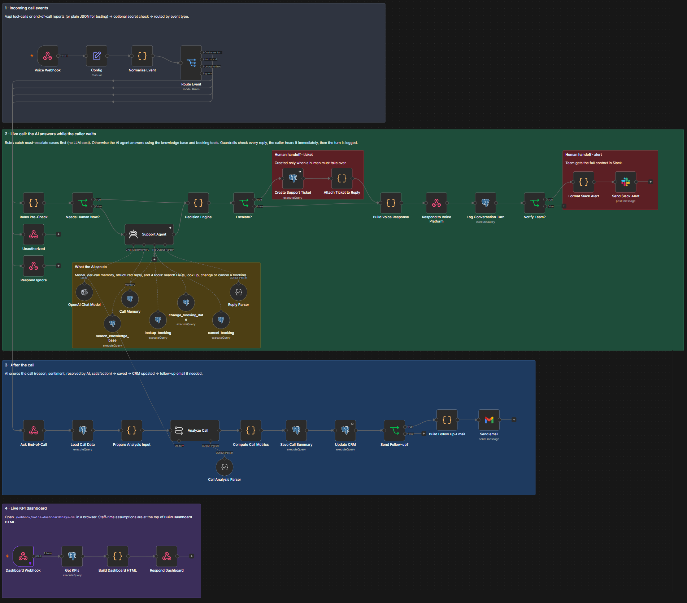

# AI Voice Customer Service Agent

A phone agent built with n8n and Vapi that answers booking and policy calls for a hotel, hands hard cases to a person, and turns every call into data: a call log, CRM updates, follow-up emails and a live KPI dashboard.

Demo build for **Grand Palm Hotel**, a fictional hotel. All guests and bookings in the database are sample data.



## Problem

Routine calls about bookings and policies take up staff time: changing dates, checking cancellation rules, confirming a reservation. Callers wait on hold, after-hours calls go unanswered, and nobody has a clear record of why people called or which calls needed a person.

## Approach

The workflow has four parts.

**1. Incoming call events**
Vapi sends each caller turn (or the end-of-call report) to an n8n webhook. The event is normalised, checked against an optional shared secret, and routed by type.

**2. Live call: the AI answers while the caller waits**
- **Rules first:** must-escalate cases (legal threats, payment problems such as double charges, refund disputes, or a caller asking for a real person) are caught by rules before any AI is called, so they are handled reliably and cost nothing.
- **Support agent:** an OpenAI agent with per-call memory (Postgres) answers using four tools: search the knowledge base, look up a booking, change booking dates, and cancel a booking.
- **Guardrails:** a decision step checks every reply before the caller hears it.
- **Human hand-off:** when a person needs to take over, a support ticket is created and the team gets a Slack alert with the full context.
- Every turn is logged.

**3. After the call**
AI analyses the whole call (reason, sentiment, whether the AI resolved it, satisfaction). The summary is saved, the customer's CRM record is updated, and a follow-up email is sent through Gmail when needed.

**4. Live KPI dashboard**
A second webhook serves an HTML dashboard for the chosen period: calls received, calls resolved by the AI, calls escalated to a person, unresolved calls, average handle time, follow-ups, average satisfaction and a comparison with the previous period, plus an estimate of staff time and cost saved (based on assumptions you set).

## Outcome

Callers get answers about their booking or the hotel's policies straight away, at any hour, and can change or cancel a booking without waiting for staff. Calls that need a person reach the team as a ticket with a Slack alert and the full context. After each call, the summary, sentiment and CRM update are recorded automatically, and the dashboard shows why people call and how many calls the agent handled.

## Tools

n8n · Vapi · OpenAI · PostgreSQL · Slack · Gmail

## Repository contents

| File | What it is |
|---|---|
| `ai-voice-customer-service-agent.json` | The n8n workflow (49 nodes), ready to import |
| `database/setup.sql` | Database tables, knowledge base and demo hotel bookings |
| `database/sample-calls.sql` | Optional sample calls so the dashboard has data |
| `images/workflow.png` | The full workflow |

## Set it up

1. **Database:** run `database/setup.sql` on a PostgreSQL database (it is safe to re-run; demo booking dates are relative to today). Optionally run `database/sample-calls.sql` to fill the dashboard.
2. **Import:** in n8n, go to **Workflows → Import from file** and choose `ai-voice-customer-service-agent.json`.
3. **Credentials:** create and select your own **Postgres**, **OpenAI**, **Gmail** and **Slack** credentials on the nodes that show a warning. Create a Slack channel called `voice-agent-alerts` (or change the channel in **Send Slack Alert**).
4. **Config node:** set your business name, assistant name, sender email and, recommended, a `shared_secret`.
5. **Voice platform:** activate the workflow and point your Vapi assistant's server URL at `POST https://<your-n8n>/webhook/voice-agent`.
6. **Dashboard:** open `https://<your-n8n>/webhook/voice-dashboard?days=30` in a browser.

### Test without a phone call

```bash
curl -X POST https://<your-n8n>/webhook/voice-agent \
  -H 'Content-Type: application/json' \
  -d '{"call_id":"demo-1","caller_phone":"+15551234567","message":"I have booking HB-12345, last name Smith. Can I move my check-in?"}'
```

End the test call with:

```json
{"event":"end_of_call","call_id":"demo-1","duration_seconds":95}
```

## Notes

- No credentials, API keys, webhook URLs or personal details are included in this repository.
- The staff-time assumptions used for "time saved" are at the top of the **Build Dashboard HTML** node, so you can set them for your own business.
- Swap the OpenAI model node for another chat model (Anthropic, Gemini) if you prefer.

---

Built by **Jeth Divina**, AI Automation Specialist · [LinkedIn](https://www.linkedin.com/in/jethdivina/)
